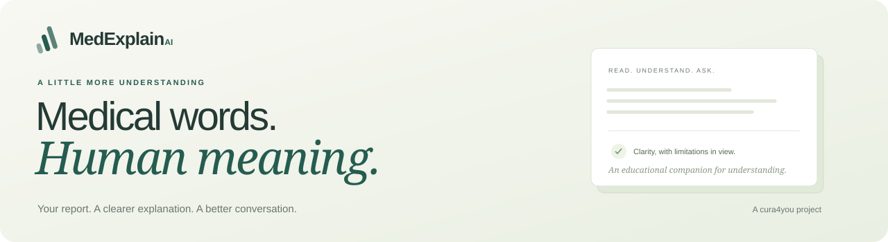
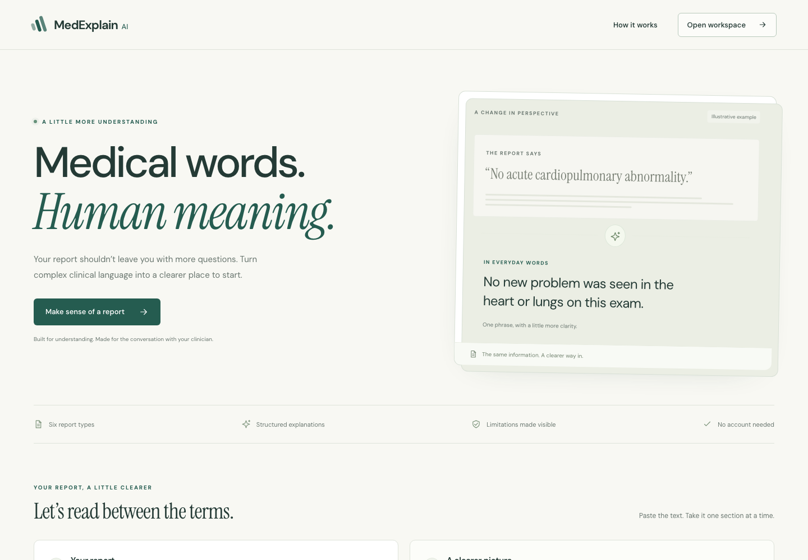
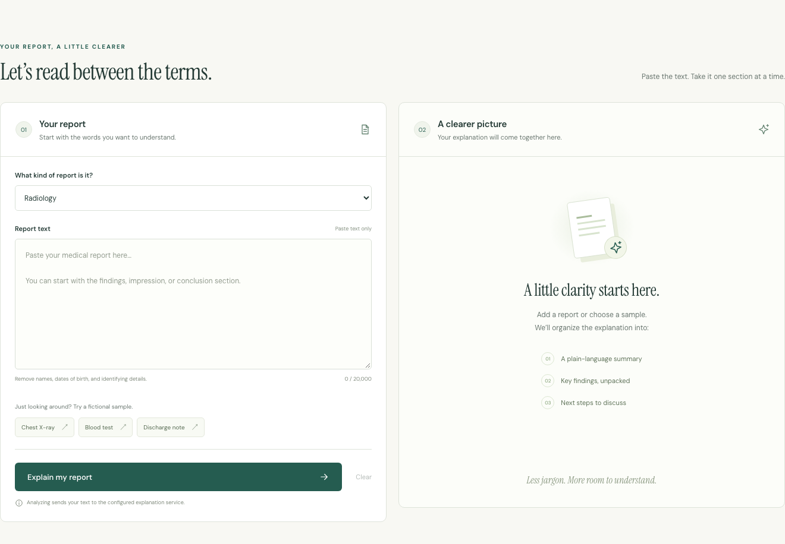
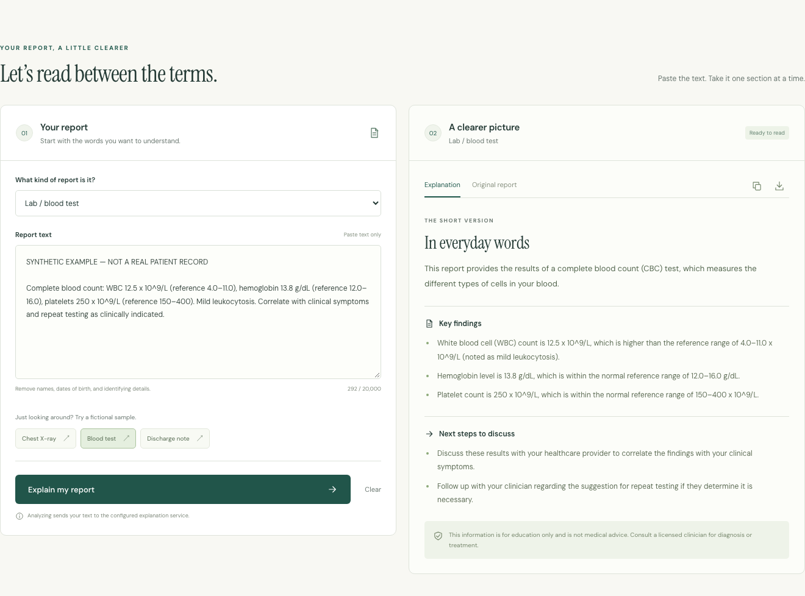
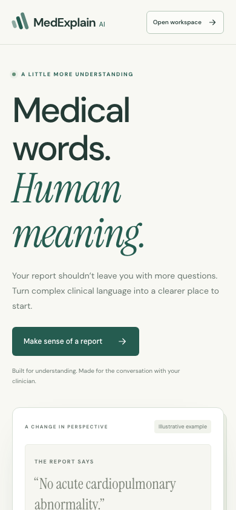
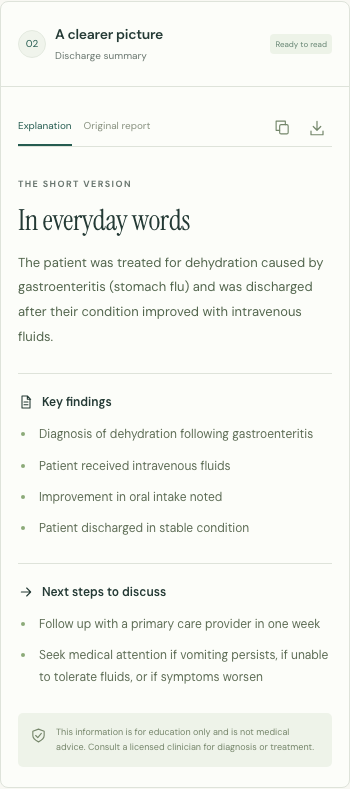
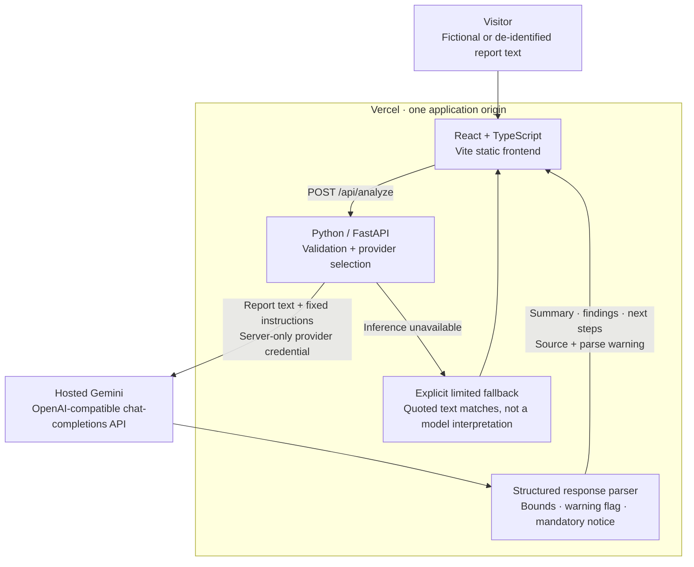

<p align="center">
  
</p>

<p align="center">
  <strong>A full-stack report explainer that turns unfamiliar clinical language into a clearer starting point.</strong><br />
  Read the explanation. Compare the original. Bring better questions to your clinician.
</p>

<p align="center">
  <a href="https://medexplain-ai-cura4you.vercel.app"><strong>Open MedExplain AI ↗</strong></a> &nbsp; · &nbsp;
  <a href="https://medexplain-ai-cura4you.vercel.app/#workspace"><strong>Try a fictional report ↗</strong></a> &nbsp; · &nbsp;
  <a href="#architecture">Architecture</a> &nbsp; · &nbsp;
  <a href="#run-locally">Run locally</a> &nbsp; · &nbsp;
  <a href="#verification">Verification</a>
</p>

<p align="center">
  
  
  
  
  
  
</p>



## From a report to a conversation

Medical reports are written for clinical precision. MedExplain AI offers another way into the same words: an educational summary, key findings, and next steps to discuss, with the original text always a tab away.

The project combines a responsive **React + TypeScript** frontend, a **FastAPI** backend, and a real hosted model. It handles the less polished parts of AI interaction too: incomplete outputs, provider outages, cancellation, malformed responses, and clearly labelled fallback results.

**Working inference and completed fine-tuning are different claims.** The verified application uses hosted Gemini. ERNIE/LoRA training remains experimental; no trained ERNIE checkpoint or completed GPU run is presented as verified. [The model and claims audit →](docs/live-model-verification/README.md)

## Try it in a minute

No account or shared credentials are needed.

1. Open the [report workspace](https://medexplain-ai-cura4you.vercel.app/#workspace) and choose **Blood test**, **Chest X-ray**, or **Discharge note**. Each is explicitly fictional.
2. Select **Explain my report**. Read the summary, findings, next steps, and educational notice.
3. Switch to **Original report** to compare the submitted text with the explanation.
4. Copy or download the explanation. Any fallback/incomplete-output warnings and the disclaimer travel with it.
5. Try the same workflow on your phone. If the service is unavailable, the interface says so and keeps your text available for retry.

Use fictional or de-identified text for portfolio exploration. An explanation helps start a conversation; your clinician interprets the report in the context of your care.

## A workspace built around understanding



### A real model response



This result came through the real **browser → FastAPI → hosted Gemini** path. The verification required `source: hosted_model`; a keyword fallback could not pass. It is distinct from the API fixtures used to test error states.

<table>
  <tr>
    <td width="50%" align="center"></td>
    <td width="50%" align="center"></td>
  </tr>
  <tr>
    <td align="center"><strong>A calmer first impression</strong><br />A responsive introduction with direct access to the workspace.</td>
    <td align="center"><strong>The same explanation, on your phone</strong><br />Readable results, comparison controls, and visible limitations.</td>
  </tr>
</table>

These are exact application captures, not composited product mockups. Landing/editor images were captured from the local application; model-result images were captured during actual hosted-inference verification. All reports are fictional. [Capture provenance](docs/readme/captures.json) · [Before and after](docs/frontend-redesign/README.md)

## What is built

| Capability | Implemented behavior |
| --- | --- |
| **Six report types** | Radiology, lab/blood, pathology, clinical notes, discharge summaries, and other text reports. |
| **Structured explanations** | Plain-language summary, findings, next steps to discuss, and a mandatory backend-supplied disclaimer. |
| **Original-text comparison** | Keyboard-operable tabs keep the exact submitted text beside the explanation workflow. |
| **Fictional samples** | Three sample reports let visitors explore without supplying personal information. |
| **Portable results** | Copy and text download include the explanation, limitations, and disclaimer. |
| **Resilient requests** | Validation, loading, cancellation, a browser deadline, stale-response prevention, and recoverable service errors. |
| **Visible model limits** | Incomplete-response warnings and a distinct, explicitly limited fallback when inference is unavailable. |
| **Responsive design** | A shared desktop/mobile layout, focus states, skip link, and reduced-motion handling. |
| **Reproducible evidence** | Separate backend, data-pipeline, browser-fixture, actual-model API, and actual-model browser checks. |

## Architecture

Production serves the frontend and Python API from the same Vercel origin. The browser sends report text to FastAPI; the backend validates the request, calls its configured model, normalizes the response, and supplies the mandatory educational notice. There is no application report database.



**The important boundary:** report content is treated as untrusted data, and provider credentials stay on the backend. The model can still make mistakes. Parsing, a disclaimer, or a 200 response does not establish clinical correctness.

<details>
<summary><strong>How the response path works</strong></summary>

1. Validate a non-whitespace report up to 20,000 characters and one of the six supported types.
2. Select an explicitly configured local checkpoint, generic hosted provider, or dedicated HF text-generation endpoint. The verified route is the generic hosted adapter using Gemini.
3. Parse structured JSON or supported text headings, including aliases and multiline sections. Bound output size and flag missing or malformed fields.
4. Supply the full educational disclaimer server-side; model output cannot remove or weaken it.
5. Return the explanation with an explicit source and `parse_warning` state. The frontend shows incomplete/fallback states and preserves their notices in exported text.

If inference is unavailable, the fallback quotes matching source excerpts with their original context. It never presents those matches as a generated medical interpretation or treats no matches as a normal result.

A browser cancellation prevents a stale reply replacing a newer result; it does not guarantee the provider stops already-started computation. Network inactivity deadlines and the browser's separate 90-second deadline have different scopes.

</details>

## Run locally

Use **Python 3.11+** and **Node.js 24**. No downloaded model weights, Torch, or Ollama are required for the hosted path.

```sh
git clone https://github.com/cura4you/MedExplain_AI.git
cd MedExplain_AI
python3 -m venv .venv
.venv/bin/pip install -r backend/requirements.txt
cp backend/.env.example backend/.env
```

| Backend setting | Purpose |
| --- | --- |
| `AI_BASE_URL` | An OpenAI-compatible chat-completions base URL. |
| `AI_MODEL` | A model available to your provider account. |
| `AI_API_KEY` | Server-only provider credential. |
| `CORS_ORIGINS` | The actual frontend origin when running separate local services. |
| `AI_TIMEOUT_SECONDS` | Provider network inactivity timeout; default 45 seconds. |

`backend/.env` loads without overwriting existing process environment values. Never put a model key in a `VITE_*` setting.

```sh
# Terminal 1: backend
.venv/bin/uvicorn backend.main:app --reload --host 127.0.0.1 --port 8000

# Terminal 2: frontend
cd frontend
npm ci
cp .env.example .env
# Set VITE_API_BASE_URL=http://localhost:8000 for separate local services.
npm run dev
```

Open the URL printed by Vite. `/health` confirms that the API process is healthy; a non-fallback analysis verifies inference. [Backend configuration](backend/README.md) · [Frontend development](frontend/README.md) · [Deployment guide](docs/DEPLOYMENT.md)

<details>
<summary><strong>API contract and source values</strong></summary>

```json
{"report_text":"SYNTHETIC TEST. No pleural effusion.","report_type":"radiology"}
```

`POST /api/analyze` returns `summary`, `key_findings`, `recommendations`, `disclaimer`, `source`, and `parse_warning`.

| Source | Meaning |
| --- | --- |
| `hosted_model` | Actual configured OpenAI-compatible model response. |
| `hf_inference` | Actual dedicated HF endpoint response; this optional path is not verified. |
| `local_model` | Actual existing checkpoint response; this optional path is not verified. |
| `fallback` | No model interpretation was generated; any matches are source excerpts only. |

Invalid report types, absent/whitespace-only text, and text over the limit return 422. Provider failures can return 200 with an explicit fallback; partial parsing returns a warning. Consumers must inspect those fields rather than equating HTTP success with a complete interpretation. [Full reference](docs/API.md)

</details>

## Verification

Each row describes a separate scope. Counts are not added together into a claim that every possible behavior was tested.

| Scope | Recorded result | Evidence |
| --- | --- | --- |
| Backend contracts | **20 tests passed**: input validation, disclaimer enforcement, parsing, bounds, provider failures, negation/context, and prompt echoes. | [Tests](backend/tests/test_api.py) |
| Synthetic data pipeline | **5 tests passed**: deterministic generation, requested sizes, leakage rejection, invalid arguments, and metric provenance. | [Tests](fine-tuning/test_pipeline.py) |
| Browser fixtures | **17 groups passed across 11 widths**: UI states, exports, keyboard access, errors, timeout, cancellation, and delayed replies. | [Report](docs/live-model-verification/ui-regression-report.json) |
| Actual hosted API | **7 scenarios passed**: six report types, selected numeric/negative evidence, mandatory notice, and one embedded-instruction case. | [Report](docs/live-model-verification/api-report.json) |
| Actual model + browser | **4 groups passed**: blood/radiology/discharge analysis, comparison, exports, and mobile rendering, with no API mocks. | [Report](docs/live-model-verification/browser-report.json) |

TypeScript/build checks passed; the frontend dependency audit reported zero known vulnerabilities at verification time. The model checks used selected synthetic facts and are application tests, not clinical accuracy measurements or proof of broad prompt-injection resistance. [Audit, transcripts, and limits](docs/live-model-verification/README.md)

<details>
<summary><strong>Reproduce the checks</strong></summary>

```sh
.venv/bin/python -m unittest discover -s backend/tests -v
python3 -m unittest discover -s fine-tuning -p 'test_*.py' -v
python3 fine-tuning/validate_data.py
npm --prefix frontend run build

# Install Chromium once, then use an already-running frontend.
(cd frontend && npx playwright install chromium)
UI_BASE=http://localhost:5173 npm --prefix frontend run test:e2e

# These checks call a real configured provider over fictional reports.
.venv/bin/python backend/live_verify.py --base-url http://localhost:8000 \
  --model-label YOUR_CONFIGURED_MODEL --output-dir /private/tmp/medexplain-live
UI_BASE=http://localhost:5173 LIVE_UI_ARTIFACTS=/private/tmp/medexplain-browser \
  node frontend/scripts/live-check.mjs
```

The API check requires `hosted_model`; fallback fails the test. The model label is operator-supplied metadata matching the configured server. Real-provider checks require a working credential and can consume provider allowance.

</details>

## Privacy, safety, and honest model claims

Reports are sent to the configured backend and AI provider. The application does not implement accounts or a report database; this does not imply zero retention by hosting/model providers. Use fictional data for public exploration and keep credentials outside Git and the frontend.

The bundled **8,000 training/evaluation rows are repetitions of 28 synthetic condition-pair templates**, not 8,000 independent clinical cases. Cases are split globally before expansion, and validation rejects exact-prompt and canonical-case overlap. Stored reference-text statistics are identified as dataset metrics, not model scores.

No trained ERNIE adapter, completed GPU run, compatible local checkpoint, or independent fine-tuned evaluation is verified. The optional LoRA code is experimental. The project preserves an audit of the original leaked split rather than presenting its historical reference-string metrics as model performance. [Training status](docs/TRAINING.md) · [Original audit](docs/live-model-verification/original-dataset-audit.json)

## Project and credits

Maintained by **[Mohammad Petiwala](https://github.com/moh0405)** under **[cura4you](https://github.com/cura4you)**. The organization transfer preserves the repository's original development history and attribution. Licensed under [MIT](LICENSE).

<p align="center"><strong>A little clarity. A more human conversation.</strong><br /><sub>Educational assistance only. Review the original report with a licensed clinician; this project is not a diagnostic or treatment tool.</sub></p>
