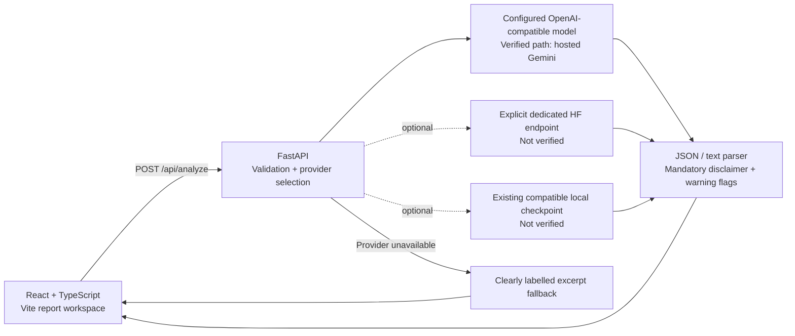

<div align="center">

# MedExplain AI

**Medical words. Human meaning.**

A full-stack educational report explainer with a React/TypeScript workspace, FastAPI backend, and configurable hosted inference.

[Frontend gallery](docs/frontend-redesign/README.md) · [Live verification](docs/live-model-verification/README.md) · [API](docs/API.md) · [Training status](docs/TRAINING.md)

</div>


## What it does

Paste medical report text, choose a report type, and receive a structured summary, key findings, next steps to discuss, and an unremovable educational disclaimer. The interface supports fictional samples, original-report comparison, text exports, cancellation, errors, and clearly labelled limited results.

**The current application was verified end to end with hosted Gemini. Completed ERNIE fine-tuning is not established.** The ERNIE model name and LoRA scripts are experimental scaffolding, not evidence of a trained model. The original “800-example evaluation” measured stored reference strings rather than model outputs; that claim has been corrected. [Full audit →](docs/live-model-verification/README.md)

## Verified capabilities

| Capability | Current behavior |
| --- | --- |
| Six report types | Radiology, lab/blood, pathology, clinical notes, discharge, and other. |
| Actual hosted inference | OpenAI-compatible chat provider; live checks used `gemini-3.1-flash-lite`. |
| Structured output | JSON and supported textual headings, multiline sections, aliases, bounded output, and partial-response warnings. |
| Explicit fallback | If inference is unavailable, return quoted keyword matches with their original negation/context. These are not clinical findings or a model interpretation. |
| Mandatory disclaimer | The backend supplies the full standard notice even if model output attempts to replace it. |
| Resilient workspace | Report validation, loading, cancellation, timeout feedback, stale-response prevention, original-text tabs, copy, and download. |
| Responsive experience | Desktop/mobile layouts, keyboard tabs and focus states, reduced-motion support, and fictional samples. |
| Training demonstration | Reproducible synthetic template generation, split-leakage checks, reference-data metrics, and experimental training scripts. No completed GPU training claimed. |

## A real model response


This capture used the actual browser → FastAPI → hosted-model path. It is separate from the synthetic API fixtures used to test UI errors. All verification reports contain fictional data only.

## Architecture



There is no account system, report database, automatic file upload, or clinical validation layer. Reports are sent to the configured backend/provider for explanation; the current application does not persist reports itself. Hosted providers can have their own retention policies. Remove identifying details before using a service configured for portfolio demonstration.

Provider priority is an explicitly configured local checkpoint, then a configured generic hosted provider, then an explicit HF text-generation endpoint. A public model card is not a hosted inference service. With no usable provider, the application returns `source: fallback` and visibly says so.

## Run locally

Use Python 3.11+ and Node.js 24 (Vite supports Node 20.19+ / 22.12+).

```sh
git clone https://github.com/cura4you/MedExplain_AI.git
cd MedExplain_AI
python3 -m venv .venv
.venv/bin/pip install -r backend/requirements.txt
cp backend/.env.example backend/.env
```

Set backend-only `AI_BASE_URL`, `AI_MODEL`, and `AI_API_KEY` for your provider. Set `CORS_ORIGINS` to the frontend's actual origin. `backend/.env` is loaded automatically without overriding existing environment values.

```sh
# Terminal 1
.venv/bin/uvicorn backend.main:app --reload --host 127.0.0.1 --port 8000

# Terminal 2
cd frontend
npm ci
cp .env.example .env
# VITE_API_BASE_URL=http://localhost:8000
npm run dev
```

Open the frontend URL printed by Vite. `/health` confirms backend process health only; a non-fallback analysis is needed to prove inference. No model weights, Torch, or Ollama are needed for the hosted path. Optional local-model dependencies are separated in `backend/requirements-local-model.txt`.

Do not put provider credentials in `VITE_*` variables. Configuration and source values are documented in [backend setup](backend/README.md) and the [API reference](docs/API.md).

## API at a glance

```json
{
  "report_text": "SYNTHETIC TEST. No pleural effusion.",
  "report_type": "radiology"
}
```

`POST /api/analyze` returns `summary`, `key_findings`, `recommendations`, `disclaimer`, `source`, and `parse_warning`.

| Source | Meaning |
| --- | --- |
| `hosted_model` | Actual response from the configured generic hosted model. |
| `hf_inference` | Actual response from a configured dedicated HF text-generation endpoint. |
| `local_model` | Actual response from an available local checkpoint. |
| `fallback` | No model interpretation was generated; matches are excerpts only. |

Whitespace-only reports, text over 20,000 characters, and invalid report types return 422. Missing or malformed model fields set `parse_warning`; model failures return an explicit fallback. A 200 response alone does not establish complete or reliable interpretation.

## Verification

The recorded verification separates actual provider calls from deterministic fixture tests:

| Scope | Result | Evidence |
| --- | --- | --- |
| Backend contracts | 20 tests passed: validation, disclaimer, parsing, bounds, negation/context, provider failure, and prompt-echo handling. | `backend/tests/test_api.py` |
| Synthetic data pipeline | 5 tests passed: deterministic split, requested size, cross-type/reordered case rejection, invalid arguments, and metric provenance. | `fine-tuning/test_pipeline.py` |
| Frontend fixture regressions | 17 groups passed across 11 widths: request payloads, UI states, exports, keyboard controls, HTTP/network/schema errors, timeout, cancellation, and stale replies. | [UI report](docs/live-model-verification/ui-regression-report.json) |
| Actual hosted API | 7 cases passed: six report types, selected numeric/negative evidence, mandatory notice, and one embedded-instruction scenario. Fallback is rejected by the checker. | [API report](docs/live-model-verification/api-report.json) |
| Actual live browser | 4 groups passed: live blood/radiology/discharge analysis, comparison, exports, and mobile rendering. No API mocking. | [Browser report](docs/live-model-verification/browser-report.json) |
| Frontend build | TypeScript + production build passed; dependency audit reported zero known frontend vulnerabilities at verification time. | [Audit scope](docs/live-model-verification/README.md) |

```sh
.venv/bin/python -m unittest discover -s backend/tests -v
python3 -m unittest discover -s fine-tuning -p 'test_*.py' -v
python3 fine-tuning/validate_data.py
npm --prefix frontend run build

# Browser fixtures, with the frontend already running:
cd frontend
npx playwright install chromium
UI_BASE=http://localhost:5173 npm run test:e2e
```

For a small real-model check against a configured API:

```sh
.venv/bin/python backend/live_verify.py --base-url http://localhost:8000 \
  --model-label YOUR_CONFIGURED_MODEL --output-dir /private/tmp/medexplain-live

UI_BASE=http://localhost:5173 LIVE_UI_ARTIFACTS=/private/tmp/medexplain-browser \
  node frontend/scripts/live-check.mjs
```

These are application checks over selected synthetic cases, not clinical accuracy measurements, a regulatory certification, or proof of ERNIE training. [Transcripts and limitations →](docs/live-model-verification/README.md)

## Training: what is and is not established

The bundled 8,000 synthetic rows are oversampled from **28 condition-pair templates**, spread over six report-type labels. They are not 8,000 independent clinical cases. The corrected split assigns 25 underlying cases to training and three to evaluation **before** expansion. Validation rejects exact-prompt and canonical-case overlap, including changed report types or reversed condition order.

`dataset_metrics.py` measures stored reference strings. It does not call a model. The misleading old `evaluate_model.py` command now fails with instructions to the correct tools. `inference_test.py` requires saved adapter configuration and weights, rather than silently substituting the base model.

No compatible trained ERNIE adapter, completed GPU run, or independent fine-tuned evaluation has been verified. The training code remains experimental; no GPU runtime or medical-quality claim is made. [Training guide →](docs/TRAINING.md)

## Deployment status

The new frontend and real-model flow are verified locally. **A new public deployment is not part of this verification release.** Railway, Render, and Vercel configuration files are templates; a working public service still needs configured backend credentials, explicit CORS, request limits, host/environment checks, and hosted smoke tests. [Deployment steps →](docs/DEPLOYMENT.md)

## Project layout

```text
backend/                 FastAPI, provider adapters, parser, contract tests
frontend/                React/TypeScript workspace, Playwright drivers
fine-tuning/             Synthetic templates and experimental training scaffolding
docs/frontend-redesign/  Before/after design captures and earlier UI evidence
docs/live-model-verification/
                         Actual provider/browser evidence and claims audit
scripts/                 Setup, Git checkpoints, guarded optional HF upload
```

Maintained by [Mohammad Petiwala](https://github.com/moh0405) under [cura4you](https://github.com/cura4you). Original history is preserved. [MIT license](LICENSE).

**Educational assistance only. AI can miss context and make mistakes. Review the original report with a licensed clinician; do not use this portfolio project for diagnosis or treatment decisions.**
