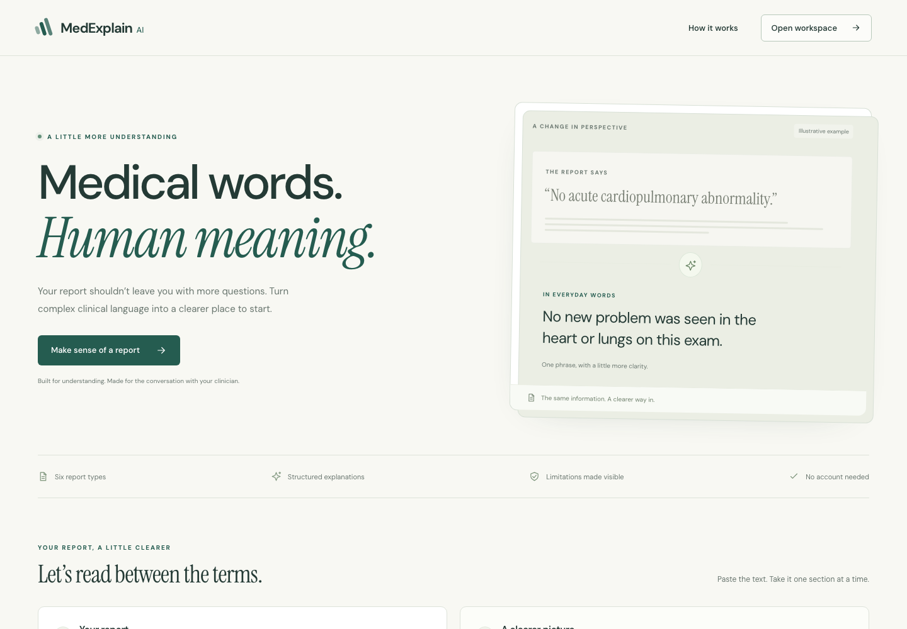

# MedExplain AI frontend redesign

The repository was transferred from `moh0405/MedExplain_AI` to `cura4you/MedExplain_AI` with its history and public visibility retained. The local checkout tracks the organization repository. Code-companion was not changed.

## Design

Deep teal, warm paper surfaces, DM Sans and Instrument Serif, a native vector mark, and an editorial opening lead into the actual report workspace. The interface remains one focused page, with six report types and three explicitly fictional sample reports.

[Full desktop](after-desktop.png) · [Mobile](after-mobile.png) · [Previous desktop](before-desktop.png) · [Previous mobile](before-mobile.png)

## Behavior improvements

- Clearly labelled inputs, character limit/count, validation feedback, and contextual submission notice.
- Loading state, disabled editing during requests, cancellation, 90-second timeout, and stale-response protection.
- Structured summary, findings, next steps, source-report comparison, and keyboard-operable tabs.
- Copy/download retains fallback or incomplete-output notices and the disclaimer.
- Distinct keyword-fallback and incomplete-model warnings; empty finding lists never imply a normal report.
- Friendly HTTP/network/JSON/schema failures preserve the user's input.
- Responsive layout, focus indicators, result focus, mobile result scrolling, skip link, and reduced-motion handling.
- No account requirement, new persistence layer, file-upload claim, or fake model result introduced.

## Verification

The browser driver uses synthetic API fixtures to exercise the frontend states, plus an actual FastAPI request with remote model inference deliberately unavailable. The real backend returned its existing keyword fallback and the UI labelled it as such. This review does **not** verify remote Hugging Face inference, model training, clinical correctness, or a new hosted deployment.

The browser report is [verification/report.json](verification/report.json). Images inside `verification/` are labelled by scenario; fixture screenshots show synthetic test output. [Actual backend fallback](verification/real-api-fallback.png).

The frontend builds with TypeScript and Vite 8. The React plugin was upgraded with it, the dependency lockfile is now tracked, and npm audit returned zero known frontend dependency vulnerabilities at verification time. That is a dependency audit result, not an overall security certification.

## Preview used for this review

- Frontend: `http://127.0.0.1:5181`
- Isolated FastAPI backend: `http://127.0.0.1:8011`
- Browser suite: `UI_REAL_BACKEND=true npm --prefix frontend run test:e2e` (set `UI_BASE` when using a different frontend port).

A public deployment and verification of the configured remote model are separate next steps.
