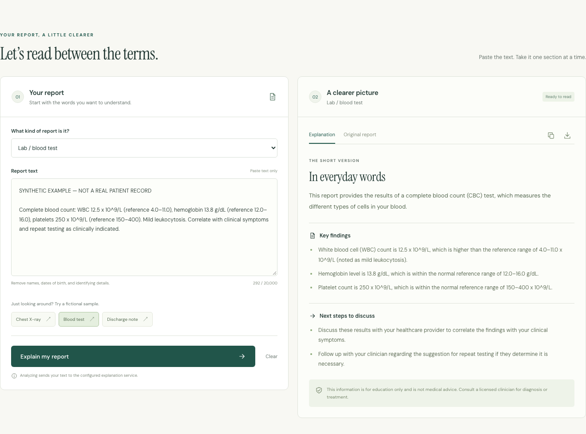

# Live model and project-claims verification — 2026-11-07

The application was exercised through a real hosted Gemini model, a real FastAPI service, and Chromium. All inputs are fictional. Provider keys remained only in the isolated API process environment; none were written to this repository, browser, screenshots, or reports.

## What passed

- **20 backend tests:** all six report types, trim/whitespace/length/type validation, mandatory disclaimer, JSON/fenced JSON, heading aliases, multiline lists, missing/malformed fields, output bounds, failure fallback, negated excerpts, word boundaries, HF prompt echo, invalid local checkpoint, and absence of an assumed HF endpoint.
- **5 pipeline tests:** deterministic requested-size generation, all six report labels, globally held-out template cases, reordered/cross-type case leakage rejection, invalid generation arguments, and honest dataset-statistics provenance.
- **17 browser regression groups:** fixture-based coverage of desktop/mobile UI, six types, three samples, request payloads, success/loading/partial/fallback states, clipboard/download, original-text keyboard tabs, stale clearing, HTTP/network/schema/JSON errors, timeout/cancellation, delayed replies, reduced motion and skip link. Layouts checked at 11 widths.
- **7 actual API scenarios:** each of six report types plus an embedded-instruction case, using configured Gemini `gemini-3.1-flash-lite`; every response required `hosted_model`, full parsing, mandatory notice and selected synthetic evidence checks. These selected regular-expression checks are not comprehensive medical fact checking.
- **4 actual Playwright groups:** browser → FastAPI → hosted model for blood, radiology and discharge samples, source comparison, exported disclaimers, and mobile results. No API routes mocked; `fallback` would fail the test.
- TypeScript/build passed. The frontend dependency audit returned zero known vulnerabilities at verification time, not an overall security guarantee.

[API report](api-report.json) · [Synthetic transcripts](synthetic-transcripts.json) · [Actual browser report](browser-report.json) · [UI regression report](ui-regression-report.json)

[Mobile live result](live-model-mobile.png)

## What was broken and corrected

1. The backend assumed a legacy public HF endpoint and had no usable configured model credential. It now supports explicit generic chat-completions configuration; the actual working verified path is hosted Gemini, identified separately from HF/local inference.
2. Model-provided disclaimer text could replace the mandatory notice. The server now always supplies the complete standard notice.
3. The parser dropped multiline sections, treated many partial outputs as complete, and could parse echoed prompt instructions. JSON/heading parsing, warning checks, output bounds and prompt/new-token handling now prevent those specific failures.
4. Empty/whitespace, arbitrary report types and excessive input were accepted. The API now enforces six types and a trimmed nonempty 20,000-character maximum.
5. Three 60-second provider attempts could exceed the browser's deadline. Inference now uses one configured network attempt with bounded inactivity timeouts. This does not establish strict wall-clock cancellation.
6. Fallback substring matching promoted negated words to apparent findings. The fallback now explicitly says no interpretation occurred, quotes the original matching excerpt, preserves negation, uses word boundaries, and avoids declaring no matches normal.
7. Runtime installation included large unused model dependencies; hosted runtime dependencies are now separate from optional local/GPU libraries. The backend also actually loads its documented `.env` file.
8. The training/evaluation claims were unsupported. All 214 unique original evaluation prompts overlapped training, and the old metrics script read reference completions without invoking any model. The original evidence is [preserved](original-dataset-audit.json); generated data now has zero exact/canonical cross-split overlap. The remaining repeated toy templates are stated plainly, not sold as independent clinical cases.
9. Fine-tuned inference silently fell back to a base model when weights were missing. Saved adapter configuration and weights are now required. Upload scripts accept arguments safely and require an explicit destination and adapter files; no upload was performed.

## Not established / remaining work

| Claim or action | Status |
| --- | --- |
| Completed ERNIE fine-tuning | **Not verified.** No saved adapter/checkpoint or GPU run evidence; no training was launched. |
| Hosted ERNIE inference | **Not verified.** No HF token or dedicated endpoint available; public metadata did not advertise a provider. |
| Local checkpoint inference | **Not verified.** No compatible saved weights available; no large model was downloaded. |
| Clinical accuracy/safety | **Not established.** Synthetic workflow checks do not validate medical use. |
| Comprehensive prompt-injection resistance | **Not established.** One live embedded-instruction case and contract checks passed; no broad safety guarantee. |
| Public production deployment | **Pending.** User requested verification before deployment. |
| GPU/library compatibility | **Experimental.** ERNIE/Unsloth architecture compatibility needs an independently budgeted hardware experiment. |
| Public API operations | Request limits, monitoring, host configuration and hosted smoke tests remain deployment work. |

## Reproduce

Run the web service with your own server-only provider settings, then use `backend/live_verify.py --base-url ... --model-label ... --output-dir ...`. The model label is operator-supplied metadata; API source checks prove an actual model response rather than cryptographic provider identity. The original run used the exact model configured in the isolated API process.

Run `frontend/scripts/live-check.mjs` with explicit `UI_BASE` and `LIVE_UI_ARTIFACTS`. The local verified preview uses frontend `http://127.0.0.1:5182` and API `http://127.0.0.1:8012`. Restart with your provider environment and matching CORS/frontend origin; do not commit or print your key. No production deployment was performed.
